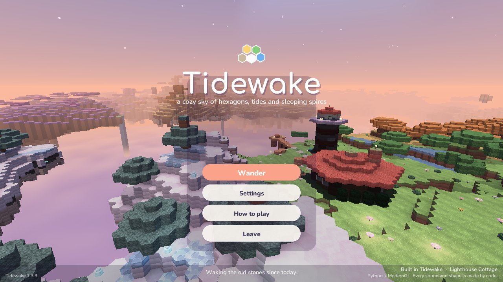
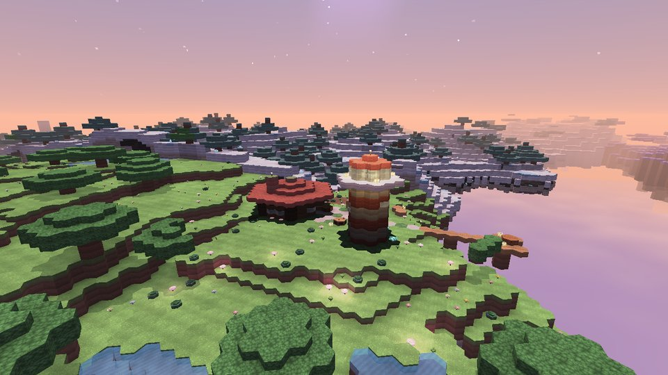
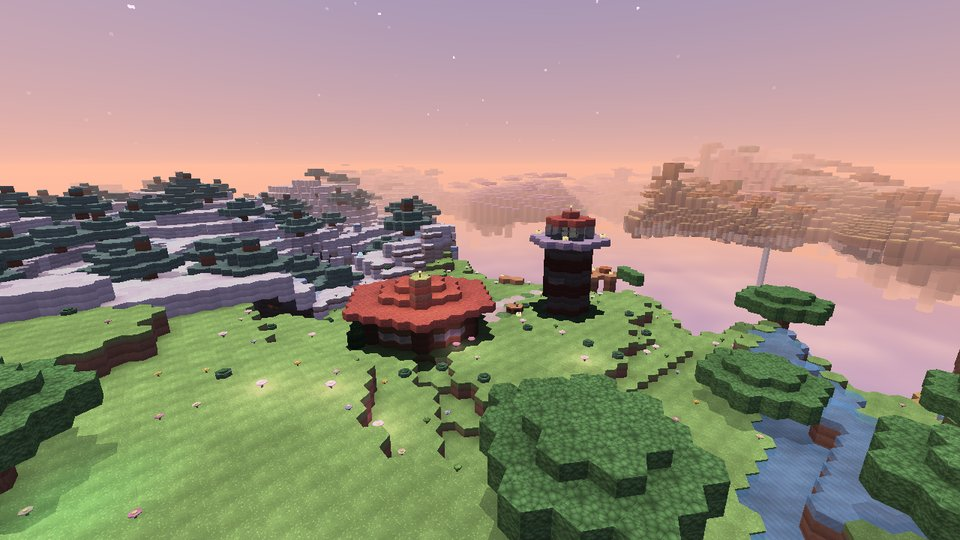
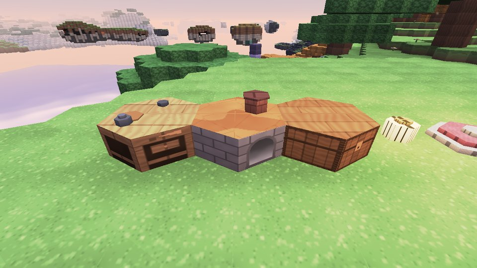
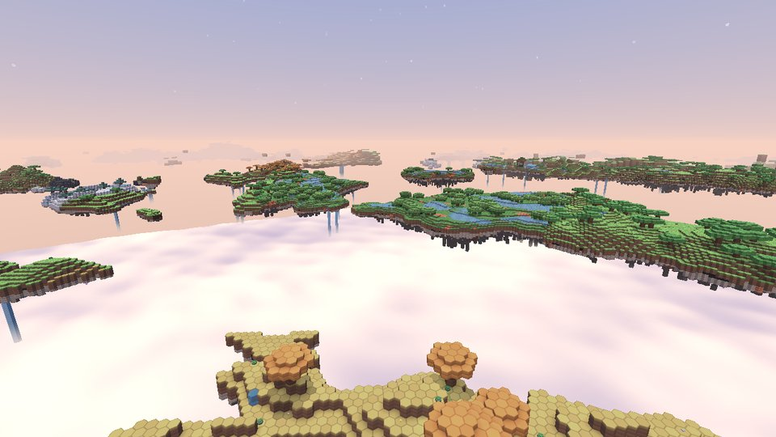
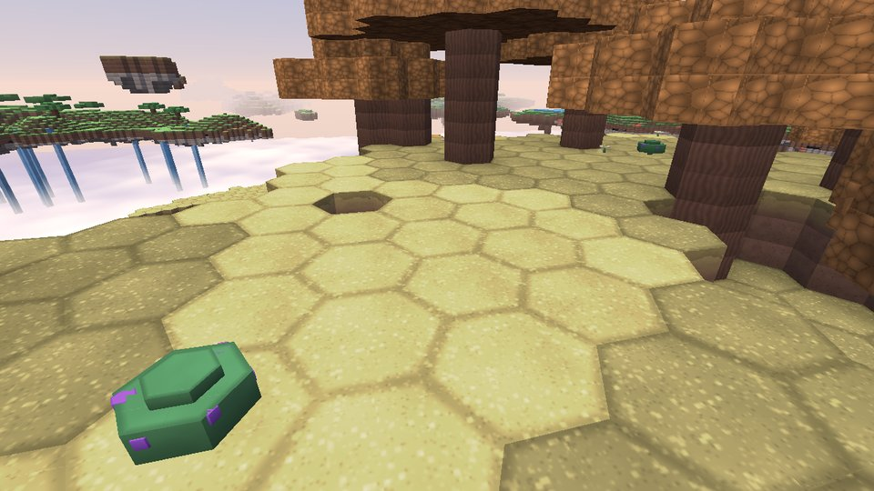
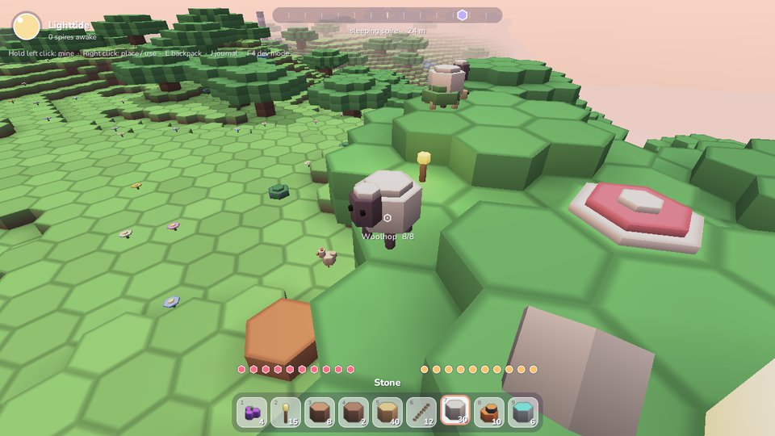
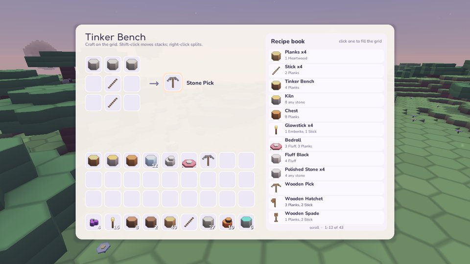
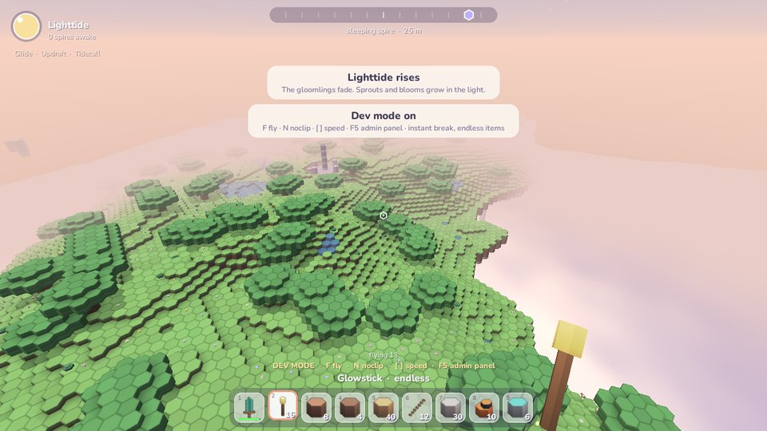

<div align="center">



# 🌊 Tidewake

**A cozy sky of floating hex-islands, gentle tides and sleeping spires.**

[](../../releases/latest)
[](../../releases/latest)
[](#-run-from-source)
[](https://github.com/moderngl/moderngl)

*Mine, craft and build on an endless archipelago made of hexagon prisms, not cubes.*

**[⬇️ Download](#%EF%B8%8F-download-windows)** · **[✨ Features](#-features)** · **[🖼️ Gallery](#%EF%B8%8F-gallery)** · **[🎮 Controls](#-controls)** · **[🛠️ Run from source](#-run-from-source)**

</div>

---

## ⬇️ Download (Windows)

> [!IMPORTANT]
> Get the game from **Releases**, not the green **Code → Download ZIP** button. That button gives you the source code, which won't run without Python installed.

1. Open the **[latest release](../../releases/latest)**.
2. Under **Assets**, download **`Tidewake-1.3.4-Windows.zip`**.
3. Right-click the zip, choose **Extract All…**, and open the `Tidewake` folder.
4. Double-click **`Tidewake.exe`**.

- 🎵 **First launch:** the game composes its soundtrack in the background (about a minute). You can play right away, and each song starts as soon as it's ready. After that the music loads instantly.
- 🛡️ **"Windows protected your PC"?** The game isn't code-signed. Click **More info**, then **Run anyway**.
- 💾 Your skies, settings and snapshots are saved next to the exe (`skies/`, `settings.json`, `snapshots/`).

> [!NOTE]
> A **1.4 Phase 3 pre-release** is up if you'd like to try the new systems early (rarer Glimmer with waystones and a Font, fishing, farming, an achievement Path that teaches as you go, and a lesson island from the title screen). It is [here](../../releases/tag/v1.4-phase3) — 1.3.4 stays the recommended download until 1.4 is finished. Your 1.3 skies still load and keep their old terrain. (The earlier [Phase 2b](../../releases/tag/v1.4-phase2b), [Phase 2a](../../releases/tag/v1.4-phase2a) and [Phase 1](../../releases/tag/v1.4-phase1) pre-releases are still there too.)


---

## ✨ Features

### ⬡ A world of hexagons
Everything is built from **hexagonal prism cells** stacked in 128 layers, with six-sided terrain, six-sided houses and six-sided everything. Cliffs, terraces, arches and overhangs come out softer and stranger than cubes.

### 🏝️ Floating islands and eight realms
Every sky is generated from a seed (any number or words) and goes on forever above a sea of clouds. There are sixteen landscapes: the original eight (**Meadow Isles, Amberwood, Rose Mesas, Frostglass, Basalt Steps, Mossfen, Duneglass, Lumen Grove**) and eight new ones — real-world-inspired **Saltwind Flats, Cedar Highlands, Lavender Downs, Cinder Spires, Chalk Barrens**, and fictional **Starfall Veil, Cloudstep Isles, Verdigris Canyons**. When you dream a new sky you can tune its shape with a dozen sliders (island size and thickness, mountains, caves, water, trees, and more). Those sliders are saved with the sky. Waterfalls pour off the edges into the cloud sea.

### ⛏️ Mining and tools
Hold left click to break blocks. Harder blocks take longer, and tools speed you up: **Wooden → Stone → Verdigris → Silverine → Aetherite** picks, axes and spades.

### 🔨 Crafting, kilns and chests
A 2×2 grid in your backpack (**E**), a 3×3 grid at the **Tinker Bench**, and a clickable recipe book. Smelt ores in the **kiln** (its firebox glows while it works), store things in **chests**, and light your home with lanterns, glowsticks and lumen lamps.

### ❤️ Survival
In **Wanderer** mode you have hearts and food. Eat berries, roast hopmeat, bake pies and stews. A **bedroll** sets your spawn and lets you sleep through the night. Fall off an island and the cloud sea carries you back to solid ground.

### 🐑 Creatures
Woolhops, pebblebeaks and mossbacks wander the meadows (fluff, hopmeat, eggs, plumes). At Dusktide, gloomlings and brutes creep out. You can switch those off in Settings.

### 🕯️ Caves and ores
Caves and caverns run under the islands, with **Emberite, Verdigris, Silverine** and **Aetherite** ore to find.

### 🌅 Tides and spires
Instead of day and night, the sky turns between warm **Lighttide** and violet **Dusktide** (about 12 minutes a cycle). Ancient **spires** sleep on every sky. Wake one to learn a gift: **Glide**, **Updraft** and **Tidecall**.

### 🎨 Procedural textures
Every block has its own hand-tuned, code-generated texture: grass speckle, cracked stone, bark, boards, bricks, ore flecks and crystal facets. The workbench, kiln and chest look like the real things and face you when you place them. Leaves sway and water flows.

### 🎶 A six-song soundtrack, made by code
Six original songs are synthesized by the game itself with music box, kalimba, marimba, steel drum, felt piano and flute over a gentle jungle groove:

| Song | When it plays |
|---|---|
| **Windward** | Title screen |
| **Lighttide** · **Brightreef** | Daytime (they take turns) |
| **Emberglow** | Evening |
| **Dusktide** | Night |
| **Cave layer** | Fades in underground |

Songs crossfade smoothly, and every sound effect is generated in code too.

### 🏡 A title-screen showcase
The main menu floats over a hand-built **Lighthouse Cottage** on a meadow headland: a timber cottage, a striped lighthouse, a workshop patio with a glowing kiln, a garden and a sky dock, filmed by a slow golden-hour camera. Builds are stored as block lists in `assets/showcase/` and picked at random, so more can be added.

### ⚡ Performance
- **Numba**-compiled terrain noise builds a chunk in about 2–3 ms.
- Near land is full detail; far islands use a light **LOD** mesh, up to 35 chunks away.
- Two view sliders in Settings: **Detail distance** (3–20 chunks) and **Far distance** (up to 35).
- The world loads what you're looking at first, using background worker processes.

---

## 🖼️ Gallery

<table>
  <tr>
    <td width="50%"><br><sub>🏡 The Lighthouse Cottage on its headland</sub></td>
    <td width="50%"><br><sub>🗼 Lighthouse, garden and stepping-stone path</sub></td>
  </tr>
  <tr>
    <td><br><sub>🔨 Workbench, kiln and chest</sub></td>
    <td><br><sub>🏝️ Islands to the horizon</sub></td>
  </tr>
  <tr>
    <td><br><sub>🍂 Amberwood and its procedural textures</sub></td>
    <td><br><sub>🐑 Woolhops and friends</sub></td>
  </tr>
  <tr>
    <td><br><sub>📖 Crafting at the Tinker Bench</sub></td>
    <td><br><sub>🕊️ Flying around in dev mode</sub></td>
  </tr>
</table>

---

## 🎮 Controls

| Key | Action |
|---|---|
| **W A S D** + mouse | Walk and look |
| **Space** | Jump · hold to glide · climb vines or ladders |
| **Shift** | Crouch (slower, lower camera, won't walk off edges). While flying, also move down. |
| **Ctrl** | Hurry |
| **C** | Fly down (while flying) |
| **Left click** (hold) | Mine · hit creatures |
| **Right click** | Place · use · eat |
| **1 – 9** / mouse wheel | Pick a hotbar slot |
| **E** | Backpack and crafting |
| **Q** | Drop the held item |
| **J** or **Tab** | Journal (recipes, spires, controls) |
| **T** | Tidecall (once learned) |
| **Enter** or **/** | Type a command (`/help`) |
| **F1 · F2 · F3** | Hide HUD · snapshot · details |
| **F11** | Fullscreen |
| **Esc** | Rest (pause, settings, save and leave) |

<details>
<summary><b>🧪 Dev mode (fly, noclip, admin panel, commands)</b></summary>

<br>

Press **F4**, or start a sky in **Dreamer** mode, to turn on dev mode. You break blocks instantly, take no damage, and creatures ignore you.

| Key | Action |
|---|---|
| **F4** | Dev mode on / off |
| **F5** | Admin panel (every item, quick buttons, command list) |
| **F** | Fly on / off |
| **N** | Noclip (fly through blocks) |
| **[** / **]** | Fly slower / faster |
| **Enter** or **/** | Type a command |

**Commands:** `/tp x z` · `/tp x y z` · `/tp spire` · `/tp spawn` · `/time` or `/tide <light|dusk|0-1>` · `/give <item> [n]` · `/spawn <creature> [n]` · `/killmobs` · `/weather <clear|rain>` · `/pos1` `/pos2` then `/fill <block>` · `/clear` · `/replace <a> <b>` · `/undo` · `/speed <n>` · `/heal` · `/feed` · `/fly` · `/noclip` · `/mobs on|off` · `/locate spire` · `/seed` · `/spawnpoint` · `/clearinv` · `/help`

</details>

---

## 🛠️ Run from source

For developers. Requires **Python 3.12** (3.10+ should work) and a GPU with OpenGL 3.3.

```bash
git clone https://github.com/GmanAwesome/tidewake.git
cd tidewake
python -m venv venv
venv\Scripts\activate            # macOS/Linux: source venv/bin/activate
pip install -r requirements.txt
python main.py
```

On Windows you can also double-click `run.bat` once the requirements are installed.

**Options:** `--size 1600x900` · `--workers N` (background world builders) · `--data PATH` (where skies, settings and the music cache are kept)

<details>
<summary><b>📦 Building the Windows exe</b></summary>

```bash
pip install pyinstaller
pyinstaller Tidewake.spec
```

The game ends up in `dist/Tidewake/`. The spec bundles the fonts, the showcase builds and the Numba-compiled noise module.

</details>

**Under the hood:** [pyglet](https://pyglet.org) (window and input), [ModernGL](https://github.com/moderngl/moderngl) (OpenGL 3.3), [NumPy](https://numpy.org), [Numba](https://numba.pydata.org) (optional, compiled terrain noise) and [pygame-ce](https://pyga.me) (SDL mixer audio). The world is pointy-top hex cells in axial coordinates, in 16×16-column chunks 128 layers tall, generated and meshed in worker processes.

---

## 📜 Version history

| Version | Highlights |
|---|---|
| **1.3.4** | Title-screen showcase: the Lighthouse Cottage, golden-hour orbit camera, builds picked at random |
| **1.3.3** | Brand-new six-song soundtrack, prepared once in the background and cached |
| **1.3.2.1** | New item icons; the workbench, kiln and chest look like the real things; no more dark block outlines |
| **1.3.2** | Procedural texture pack; sound moved to the SDL mixer (no dropouts or pops) |
| **1.3.1** | Smoother music; separate Detail and Far view-distance sliders |
| **1.3** | Numba-compiled terrain, far-island LOD, twice the view distance, more dramatic terrain |
| **1.2** | About twice the frame rate with many creatures; calmer music |
| **1.1** | Mining, tools, crafting, kiln, chests, survival, creatures, caves and ores, dev mode |
| **1.0** | The first sky: hex islands, elements, tides and sleeping spires |

All builds are on the **[Releases](../../releases)** page.

---

## 💛 Credits

- Made by **[Gentry Irvin](https://github.com/GmanAwesome)**.
- Every shape, texture, sound and song is generated in code. There are no image or audio files.
- Fonts: **Comfortaa** and **Nunito** (SIL Open Font License, see `assets/fonts/OFL.txt`).
- Built with pyglet, ModernGL, NumPy, Numba and pygame-ce.

<div align="center">

<sub>Made with love, and no cubes. ⬡</sub>

</div>
