<div align="center">

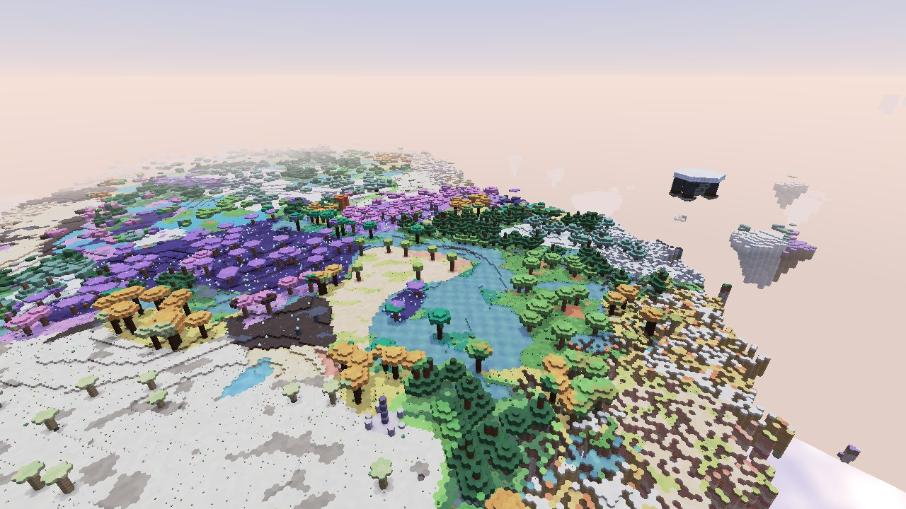

# Tidewake

**An endless sky of floating hexagon islands to explore, mine, craft and build on.**

Every sky is grown from a seed: huge islands in twenty landscapes, trees from bushes to giants, and grand structures to stumble on. You'll find hot air balloons drifting between islands, sky cities, floating fortresses, world trees and titan ruins. Everything is made of hexagonal prisms, not cubes.

### [⬇ Download Tidewake 1.4.4 for Windows](https://github.com/GmanAwesome/tidewake/releases/latest)

[Gallery](#gallery) · [Features](#features) · [Controls](#controls) · [Build from source](#build-from-source) · [Changelog](CHANGELOG.md)

</div>

---

## Download and play (Windows)

1. Open the **[latest release](https://github.com/GmanAwesome/tidewake/releases/latest)**. Under **Assets**, download **`Tidewake-1.4.4-Windows.zip`**. Don't use the green **Code → Download ZIP** button; that's the source code.
2. **Unzip it**: right-click the zip, choose **Extract All…**, and open the `Tidewake` folder.
3. **Double-click `Tidewake.exe`.**

If Windows shows **"Windows protected your PC"**, the game isn't code-signed. Click **More info**, then **Run anyway**.

On first launch the soundtrack is composed in the background, which takes about a minute. You can play right away; each song starts as soon as it's ready. Skies, settings and snapshots are saved next to the exe.

---

## Gallery

<table>
  <tr>
    <td width="50%">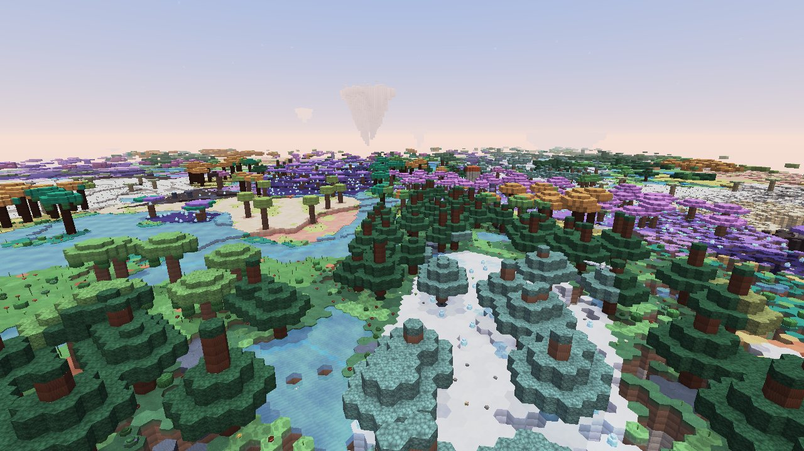<br><sub>Cedar Highlands on seed <code>-1565669544</code>, near x -1603, z -2679</sub></td>
    <td width="50%">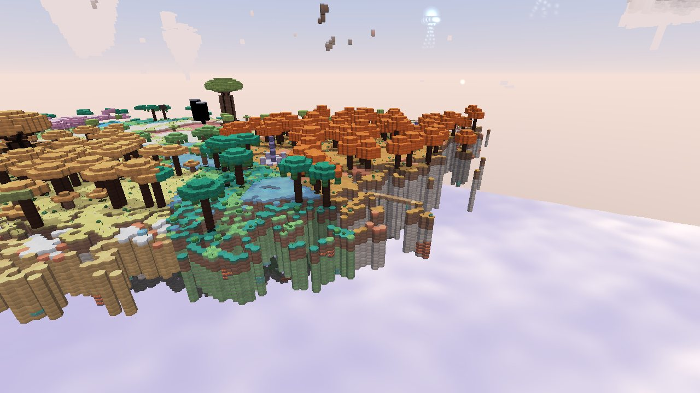<br><sub>A big island near spawn</sub></td>
  </tr>
  <tr>
    <td width="50%">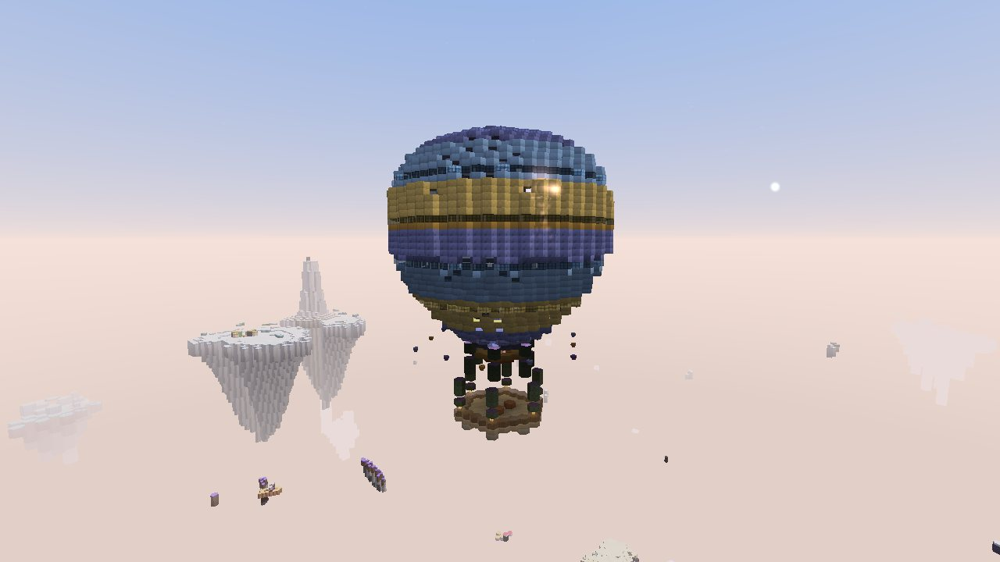<br><sub>A hot air balloon. Every one is seeded differently.</sub></td>
    <td width="50%">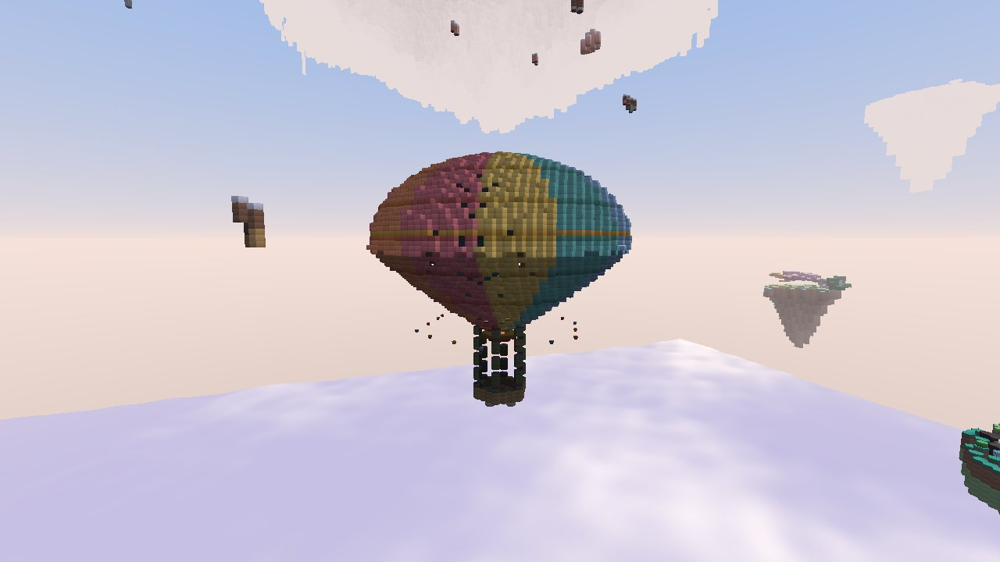<br><sub>A patchwork balloon with a wicker basket</sub></td>
  </tr>
  <tr>
    <td width="50%">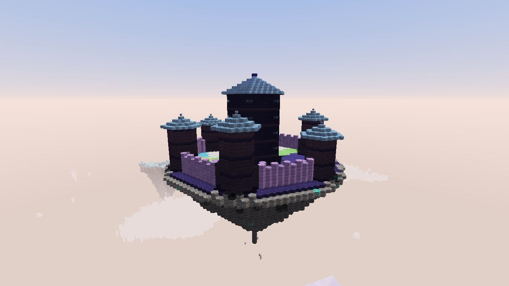<br><sub>A floating fortress</sub></td>
    <td width="50%">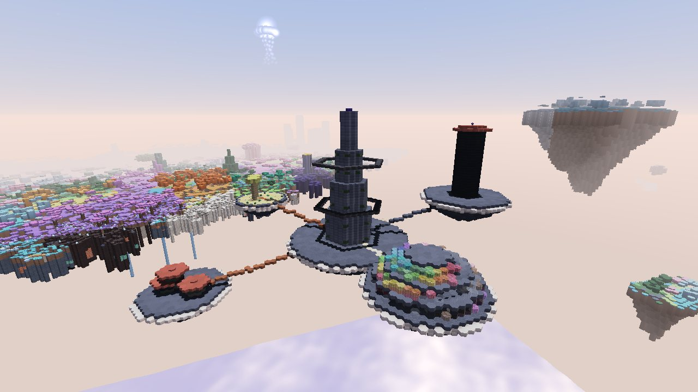<br><sub>A sky city</sub></td>
  </tr>
  <tr>
    <td width="50%">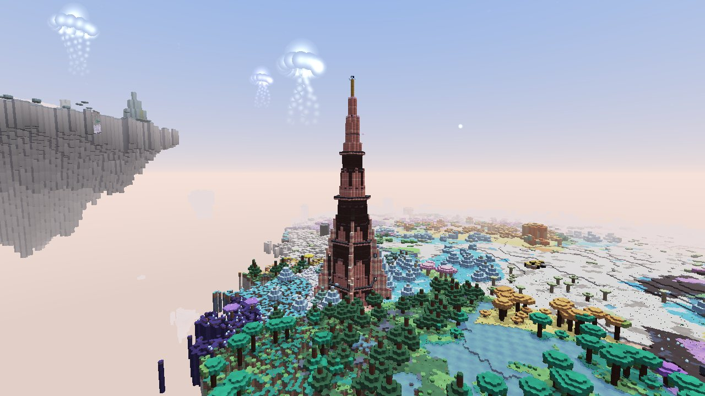<br><sub>A megaspire</sub></td>
    <td width="50%">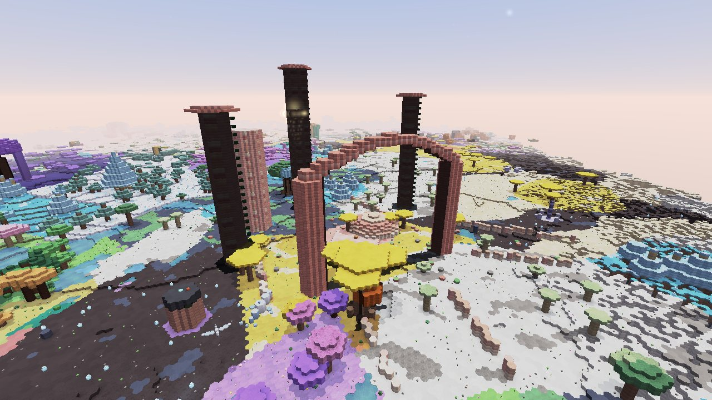<br><sub>Titan ruins</sub></td>
  </tr>
  <tr>
    <td width="50%">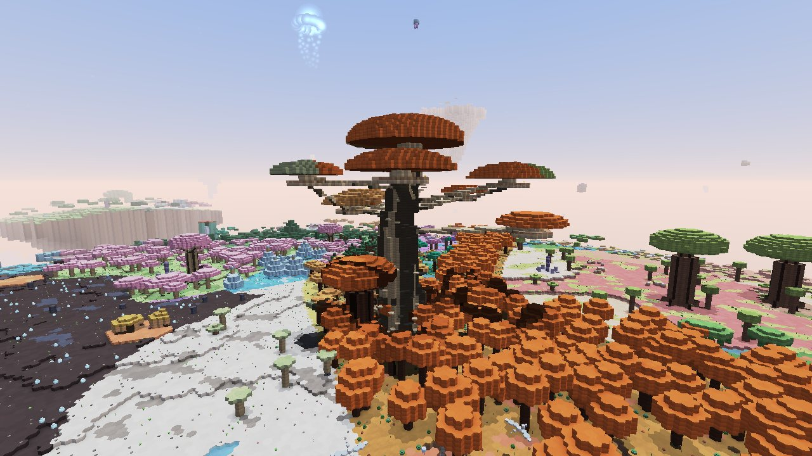<br><sub>A world tree</sub></td>
    <td width="50%">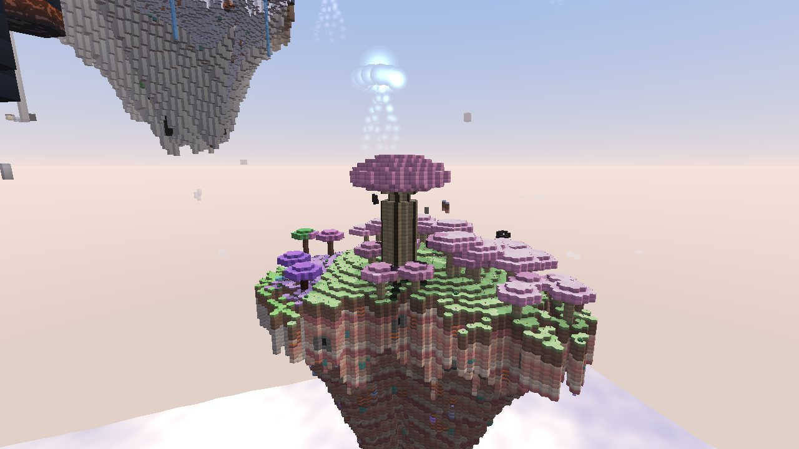<br><sub>Blossom Vale: small, medium and huge trees</sub></td>
  </tr>
  <tr>
    <td width="50%">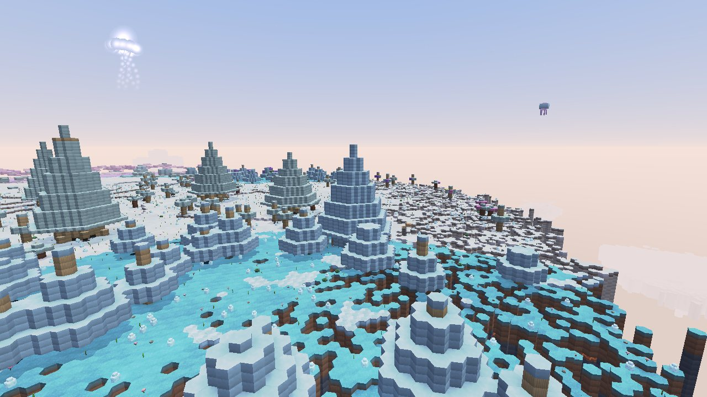<br><sub>Azure Fields</sub></td>
    <td width="50%">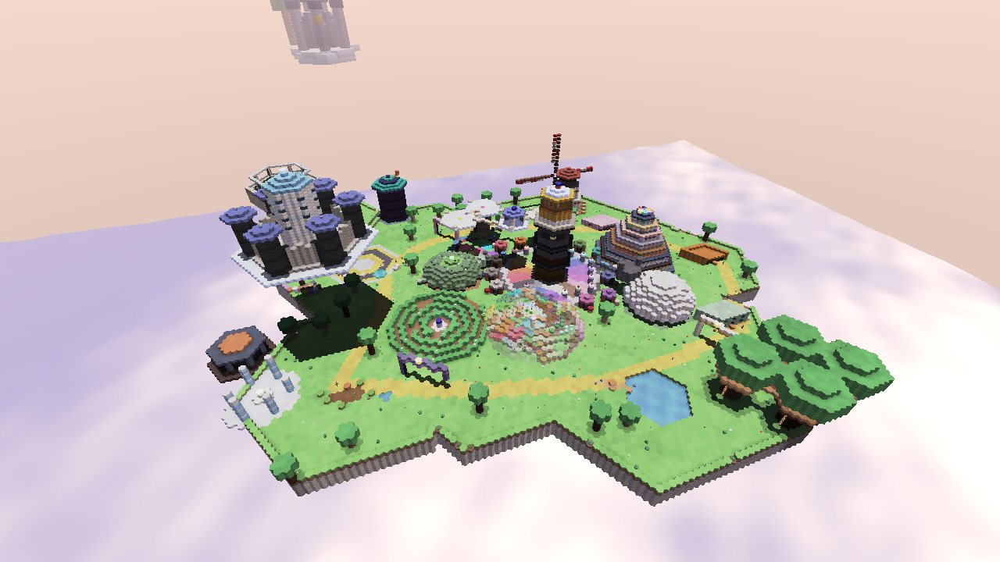<br><sub>The lesson island</sub></td>
  </tr>
</table>

---

## Features

### Sky islands without end
- Every sky is generated from a seed (any number or words) and goes on forever above a sea of clouds.
- Islands range from tiny floating rocks to continents hundreds of cells across. Shelves of land stack through a 500-layer sky, so you'll see islands above and below you.
- The whole world is built from hexagonal prism cells, so cliffs, terraces, arches and overhangs come out softer and stranger than cubes.
- There are caves, lakes and waterfalls. When you dream a new sky, sliders tune island size and thickness, mountains, caves, water, trees and more.

### Twenty landscapes
- Meadow Isles, Amberwood, Rose Mesas, Frostglass, Basalt Steps, Mossfen, Duneglass, Lumen Grove, Saltwind Flats, Cedar Highlands, Lavender Downs, Cinder Spires, Chalk Barrens, Starfall Veil, Cloudstep Isles and Verdigris Canyons.
- **New in 1.4.4:**
  - **Blossom Vale** with pink canopies
  - **Autumn Wilds** in orange
  - **Azure Fields** with frosted blue trees and ice pools
  - **Golden Steppe** with flat-topped golden acacias

### Trees in every size
- **Small** bush-trees, **medium** trees in each landscape's own shape, and rare **huge** trees 18–34 layers tall.
- The huge ones include oaks, cedars, vine-hung willows, acacias and glowing toadstools.
- Canopies are tall enough to walk under.

### Grand structures
Rare, seeded structures that you find out in the world, no two alike:
- **Hot air balloons**: huge envelopes in round, teardrop, tall, pumpkin and onion shapes, patterned with stripes, bands, harlequin, spirals, chevrons, patchwork or rainbows. They hang over baskets, decks, boats or cabins, with ropes, a glowing burner and cargo chests.
- **Sky cities** of linked platforms around a spire, and **floating fortresses** with towers and a keep.
- **World trees** with huts in their branches and rope bridges.
- **Megaspires** in buttress, pagoda, crystal and helix styles, plus **colossi** and **titan ruins**.
- **Villages**, **flying airships**, **watchtowers**, and leviathan and airship **wrecks**.
- Smaller finds too: hamlets, shrines, windmills, lighthouses, markets, observatories, sky temples and buried chambers.

### Glimmer and the Tidewell
Floating **Glimmer** motes drift in the air, and they're most plentiful at dusk.
1. **Catch** a mote by walking into it.
2. **Spend 1** to attune a **waystone**. Once two are attuned, travel between them is free.
3. **Spend 2–4** at a **Tidewell** on a lasting gift for that sky, such as Mote Sense, Keen Reach, Lightfoot, Deep Breath or Brightwake.

Ancient **spires** sleep on every sky. Wake one to learn Glide, Updraft or Tidecall. The **Path** quietly points at what to try next.

### The lesson island
**Learn to play** opens a hand-built island that teaches moving, gathering, crafting, doors, fishing, farming and Glimmer. It's packed with showpieces that together use every block in the game:
- a rainbow plaza with a cosmic clocktower, a 16-colour bazaar and a stepped Hall of Stones
- a stained-glass conservatory, a giant turtle monument, and a bounce park with a sky funfair
- an observatory, a treehouse grove, a windmill, a hedge maze and a floating sky castle

It also has a friendly cast of creatures and no hostiles.

### Survival basics
- **Mining:** hold left click to mine. Tools go from wood through stone, Verdigris, Silverine and Aetherite.
- **Crafting:** craft on a 2×2 grid in your backpack or at a **Tinker Bench**, and smelt ore in a **kiln**.
- **Health and rest:** in Wanderer mode you have hearts and food. A bedroll sets your spawn and lets you rest into dawn. Falling off an island lands you in the cloud sea, which carries you back.
- **Fishing and farming:** fishing changes with the landscape and the tide, and you can farm skywheat, sweetroot and berries.
- **Building:** more than 250 blocks, including 16 dyes, stained glass, crystal lamps, banners, terrazzo, metals and bounce jellies.
- **Creatures:** woolhops, pebblebeaks, moss turtles, sky jellies, cloud rays, islekits, skywhales and fairies. At Dusktide, gloomlings and brutes creep out.
- **The sky's cycle:** instead of day and night, the sky turns between warm **Lighttide** and violet **Dusktide**.
- **Music:** an original soundtrack, written entirely in code, crossfades between landscapes, caves, rain and underwater.

---

## Controls

| Key | Action |
|---|---|
| **W A S D** + mouse | Walk and look |
| **Space** | Jump · hold to glide · climb vines or ladders |
| **Shift** | Crouch (won't walk off edges) · move down while flying |
| **Ctrl** | Hurry |
| **Left click** (hold) | Mine · hit creatures |
| **Right click** | Place · use · eat · cast or reel · open a door |
| **1–9** / mouse wheel | Pick a hotbar slot |
| **E** | Backpack and crafting |
| **Q** | Drop the held item |
| **J** or **Tab** | Journal (recipes, spires, controls) |
| **P** | The Path |
| **T** | Tidecall (once learned) |
| **F5** | First person / third person / looking at you |
| **Enter** or **/** | Type a command (`/help`) |
| **F1 · F2 · F3** | Hide HUD · snapshot · details |
| **F11** | Fullscreen |
| **Esc** | Rest menu (pause, settings, save and leave) |

<details>
<summary><strong>Dreamer mode, dev mode and commands</strong></summary>

<br>

Start a sky in **Dreamer** mode, or press **F4**, to break blocks instantly, take no damage and be ignored by creatures.

| Key | Action |
|---|---|
| **F4** | Dev mode on / off |
| **F7** | Admin panel (every item, quick buttons; needs dev mode) |
| **F** | Fly on / off |
| **N** | Noclip |
| **[** / **]** | Fly slower / faster |
| **C** | Fly down |
| **Middle click** | Remove an item (Dreamer or dev) |

**Commands:** `/tp x z` · `/tp x y z` · `/tp spire` · `/tp spawn` · `/tide <light|dusk|0-1>` · `/give <item> [n]` · `/spawn <creature> [n]` · `/killmobs` · `/weather <clear|rain>` · `/pos1` `/pos2` then `/fill <block>` · `/replace <a> <b>` · `/undo` · `/speed <n>` · `/heal` · `/feed` · `/fly` · `/noclip` · `/mobs on|off` · `/locate spire` · `/seed` · `/spawnpoint` · `/clearinv` · `/help`

</details>

---

## Build from source

You need **Python 3.12** (3.10+ should work) and a GPU with OpenGL 3.3.

```bash
git clone https://github.com/GmanAwesome/tidewake.git
cd tidewake
python -m venv venv
venv\Scripts\activate            # macOS/Linux: source venv/bin/activate
pip install -r requirements.txt
python main.py
```

On Windows you can also double-click `run.bat` once the requirements are installed.

**Options:** `--size 1600x900` · `--workers N` (background world builders) · `--data PATH` (where skies, settings and the music cache are kept)

**Tests:** run any file in `tests/` with `PYTHONPATH=. python tests/<name>.py`.

<details>
<summary><strong>Building the Windows exe</strong></summary>

```bash
pip install pyinstaller
pyinstaller Tidewake.spec
```

The game ends up in `dist/Tidewake/`. Release builds also embed a Common Controls v6 manifest and the app icon in the exe.

</details>

**Under the hood:**
- [pyglet](https://pyglet.org) for the window and input, and [ModernGL](https://github.com/moderngl/moderngl) for OpenGL 3.3 rendering
- [NumPy](https://numpy.org), plus [Numba](https://numba.pydata.org) (optional) for compiled terrain noise
- [pygame-ce](https://pyga.me) for SDL mixer audio

The world is pointy-top hex cells in axial coordinates, in 16×16-column chunks 500 layers tall. Chunks are generated and meshed in worker processes.

---

## Changelog

**1.4.4** is the current release. Its highlights:
- islands about 50% larger, in a 500-layer sky
- grand seeded structures
- four new landscapes with coloured foliage
- trees in three sizes
- the Tidewell and a clearer Glimmer loop
- a lesson island rebuilt with showpieces

The full history is in **[CHANGELOG.md](CHANGELOG.md)**, and every build is on the **[Releases](https://github.com/GmanAwesome/tidewake/releases)** page.

---

## Credits and notes

- Made by **[Gentry Irvin](https://github.com/GmanAwesome)**.
- Every shape, texture, sound and song is generated in code. There are no sampled instruments and no ripped image packs.
- The music is original. A hint of the folk tune **Korobeiniki**, which is in the **public domain**, runs through the soundtrack, and nothing is copied from other games.
- Fonts: **Comfortaa** and **Nunito** (SIL Open Font License, see `assets/fonts/OFL.txt`).
- Built with pyglet, ModernGL, NumPy, Numba and pygame-ce.

<div align="center">

<sub>Made with care, and no cubes. ⬡</sub>

</div>
