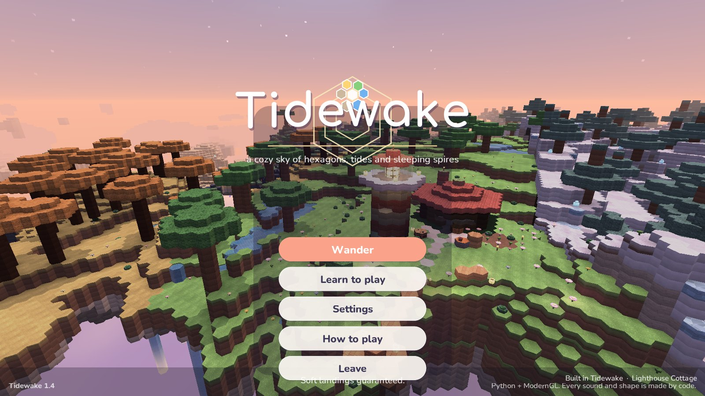
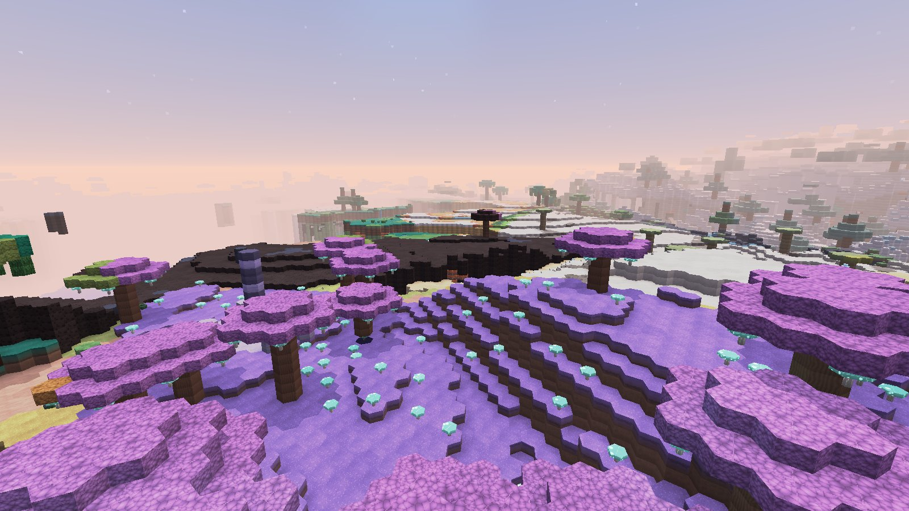
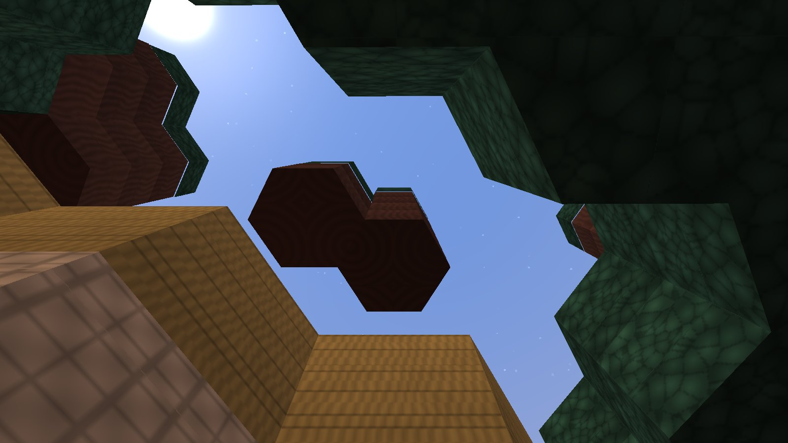
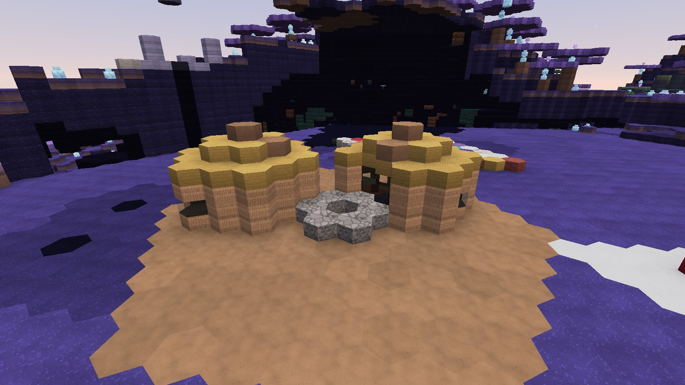
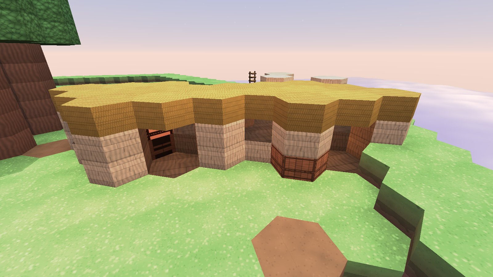
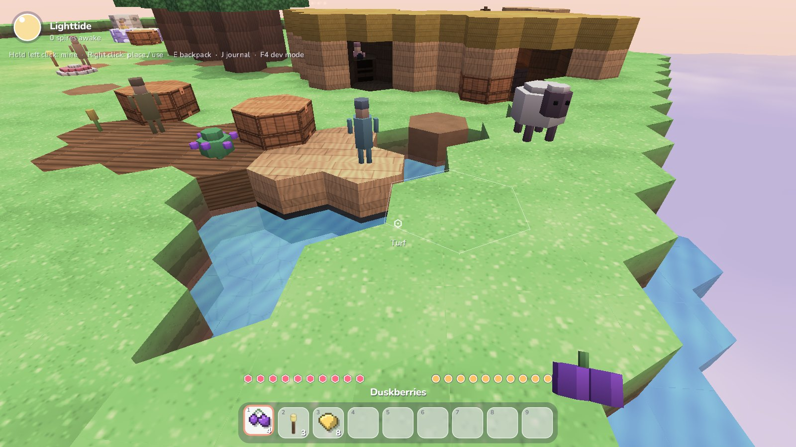
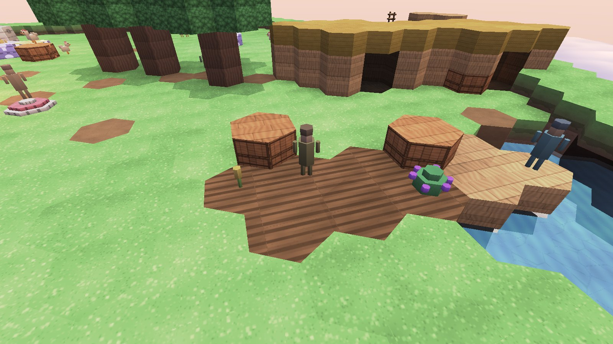
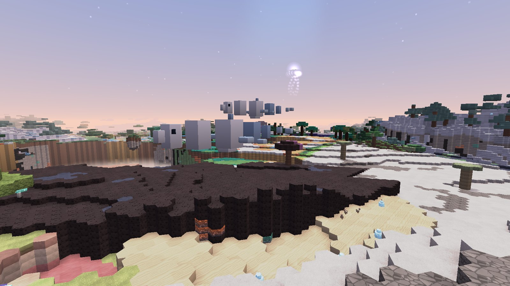
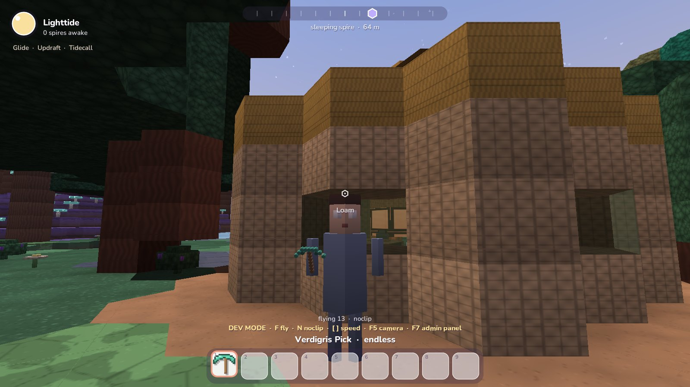

<div align="center">



# Tidewake

A cozy sky of floating hexagon islands, gentle tides and sleeping spires.

[Download](../../releases/latest) · [Features](#features) · [Controls](#controls) · [Changelog](CHANGELOG.md)

Mine, craft and build on an endless archipelago made of hexagonal prisms, not cubes.

</div>

---

## Download (Windows)

Get the game from **Releases**, not the green **Code → Download ZIP** button. That button gives you the source, which will not run without Python.

1. Open the **[latest release](../../releases/latest)**.
2. Under Assets, download **`Tidewake-1.4.1-Windows.zip`**.
3. Right-click the zip, choose **Extract All…**, and open the `Tidewake` folder.
4. Double-click **`Tidewake.exe`**.

First launch composes the soundtrack in the background (about a minute). You can play right away; each song starts as soon as it is ready, and later launches load the music instantly.

If Windows shows **“Windows protected your PC”**, the game is not code-signed. Click **More info**, then **Run anyway**.

Your skies, settings and snapshots are saved next to the exe (`skies/`, `settings.json`, `snapshots/`). Skies from 1.3 still load and keep their original terrain.

---

## Features

### A world of hexagons

Everything is built from hexagonal prism cells stacked in 128 layers. Cliffs, terraces, arches and overhangs come out softer and stranger than cubes. Every sky is generated from a seed — any number or words — and goes on forever above a sea of clouds.

There are sixteen landscapes: Meadow Isles, Amberwood, Rose Mesas, Frostglass, Basalt Steps, Mossfen, Duneglass, Lumen Grove, Saltwind Flats, Cedar Highlands, Lavender Downs, Cinder Spires, Chalk Barrens, Starfall Veil, Cloudstep Isles and Verdigris Canyons. When you dream a new sky you can tune its shape with sliders for island size and thickness, mountains, caves, water, trees, Glimmer and more. Those sliders are saved with the sky.

Trees grow tall enough that you can walk under most canopies. Caves run under the islands without turning the land into cheese, even when those sliders are turned all the way up.

<table>
  <tr>
    <td width="50%"><br><sub>A generated sky on the current generator</sub></td>
    <td width="50%"><br><sub>Under a canopy in a generated world</sub></td>
  </tr>
</table>

### Settlements, ruins and a lesson island

New skies can grow a hut, a small village, a temple, a ring of standing stones, a buried chamber or a sky boat moored at an island edge, weathered as intact, abandoned, ruined or overgrown. Buried chambers are lit, so the room at the bottom of the shaft is a place you can see.

**Learn to play** opens a hand-built lesson island that walks you through moving, gathering, crafting, doors, fishing, farming and Glimmer.

<table>
  <tr>
    <td width="50%"><br><sub>A settlement on a new sky</sub></td>
    <td width="50%"><br><sub>The lesson island</sub></td>
  </tr>
</table>

### Mining, crafting and survival

Hold left click to break blocks. Tools speed you up, from wooden through stone, Verdigris, Silverine and Aetherite. Craft in a 2×2 grid in your backpack (**E**) or at a **Tinker Bench**, and smelt ores in the **kiln**. In Wanderer mode you have hearts and food — berries, roast hopmeat, pies and stews. A bedroll sets your spawn and, at dusk, fades the world into a dawn instead of snapping the light. Fall off an island and the cloud sea carries you back to solid ground.

Fishing and farming are part of the usual loop: a craftable rod, bites that change with the landscape and the tide, a hoe, tilled beds, and skywheat, sweetroot and berry crops.

<table>
  <tr>
    <td width="50%"><br><sub>Fishing</sub></td>
    <td width="50%"><br><sub>A small farm</sub></td>
  </tr>
</table>

### Glimmer, the Path and creatures

Golden **Glimmer** motes drift in the air, rarer in the day and richer at dusk. Spend them at a **waystone** to travel, or at the **Glimmer Font** for lasting gifts. The **Path** keeps track of what you have done and quietly points at what to try next.

Woolhops, pebblebeaks and mossbacks wander the meadows. At Dusktide, gloomlings and brutes creep out. **Skywhales** drift slowly between islands, and **fairies** glow near flowers as evening comes on — both peaceful, and kept off the lesson island. F5 cycles first person, third person and looking-at-you; the figure you see wears only what you are actually holding or have found.

<table>
  <tr>
    <td width="50%"><br><sub>A skywhale</sub></td>
    <td width="50%"><br><sub>Looking at you</sub></td>
  </tr>
</table>

### Tides, music and the title screen

Instead of day and night, the sky turns between warm **Lighttide** and violet **Dusktide** (about twelve minutes a cycle). Ancient **spires** sleep on every sky. Wake one to learn a gift: Glide, Updraft and Tidecall.

The soundtrack is original and written in code — music box, kalimba, marimba, steel drum, felt piano and flute over a gentle groove. Lighttide, Brightreef, Highmere, Emberglow, Dusktide, Firstlight (the lesson island), Undertide (underwater), Rainwake (rain) and a cave layer take their turns and crossfade. A public-domain hint of Korobeiniki runs through the family; nothing is copied from other games. Every sound effect is generated in code too.

The title screen has an animated logo and a rotating backdrop: the Lighthouse Cottage and a handful of strong seeds on the current generator.

Every block has its own hand-tuned, code-generated texture. Near land is full detail; far islands use a light LOD mesh. Two sliders in Settings set detail distance and far distance.

---

## Controls

| Key | Action |
|---|---|
| **W A S D** + mouse | Walk and look |
| **Space** | Jump · hold to glide · climb vines or ladders |
| **Shift** | Crouch (slower, lower camera, will not walk off edges). While flying, also move down. |
| **Ctrl** | Hurry |
| **C** | Fly down (while flying) |
| **Left click** (hold) | Mine · hit creatures |
| **Right click** | Place · use · eat · cast or reel · open a door |
| **1–9** / mouse wheel | Pick a hotbar slot |
| **E** | Backpack and crafting |
| **Q** | Drop the held item |
| **J** or **Tab** | Journal (recipes, spires, controls) |
| **P** | The Path |
| **T** | Tidecall (once learned) |
| **F5** | Cycle first person / third person / looking at you |
| **Enter** or **/** | Type a command (`/help`) |
| **F1 · F2 · F3** | Hide HUD · snapshot · details |
| **F11** | Fullscreen |
| **Esc** | Rest (pause, settings, save and leave) |

<details>
<summary><strong>Dev mode, Dreamer mode and commands</strong></summary>

<br>

Press **F4**, or start a sky in **Dreamer** mode, to turn on dev mode. You break blocks instantly, take no damage, and creatures ignore you. In Dreamer mode (and while dev mode is on), **middle-click** removes an item from your inventory.

| Key | Action |
|---|---|
| **F4** | Dev mode on / off |
| **F5** | Cycle first person / third person / looking at you |
| **F7** | Admin panel (every item, quick buttons, command list; needs dev mode) |
| **F** | Fly on / off |
| **N** | Noclip (fly through blocks) |
| **[** / **]** | Fly slower / faster |
| **Middle click** | Remove an item (Dreamer or dev) |
| **Enter** or **/** | Type a command |

**Commands:** `/tp x z` · `/tp x y z` · `/tp spire` · `/tp spawn` · `/time` or `/tide <light|dusk|0-1>` · `/give <item> [n]` · `/spawn <creature> [n]` · `/killmobs` · `/weather <clear|rain>` · `/pos1` `/pos2` then `/fill <block>` · `/clear` · `/replace <a> <b>` · `/undo` · `/speed <n>` · `/heal` · `/feed` · `/fly` · `/noclip` · `/mobs on|off` · `/locate spire` · `/seed` · `/spawnpoint` · `/clearinv` · `/help`

</details>

---

## Run from source

For developers. Requires **Python 3.12** (3.10+ should work) and a GPU with OpenGL 3.3.

```bash
git clone https://github.com/GmanAwesome/tidewake.git
cd tidewake
python -m venv venv
venv\Scripts\activate            # macOS/Linux: source venv/bin/activate
pip install -r requirements.txt
python main.py
```

On Windows you can also double-click `run.bat` once the requirements are installed.

**Options:** `--size 1600x900` · `--workers N` (background world builders) · `--data PATH` (where skies, settings and the music cache are kept)

<details>
<summary><strong>Building the Windows exe</strong></summary>

```bash
pip install pyinstaller
pyinstaller Tidewake.spec
```

The game ends up in `dist/Tidewake/`. The spec bundles the fonts, the showcase builds and the Numba-compiled noise module. Shipping builds also embed a Common Controls v6 manifest and the app icon in the exe.

</details>

**Under the hood:** [pyglet](https://pyglet.org) (window and input), [ModernGL](https://github.com/moderngl/moderngl) (OpenGL 3.3), [NumPy](https://numpy.org), [Numba](https://numba.pydata.org) (optional, compiled terrain noise) and [pygame-ce](https://pyga.me) (SDL mixer audio). The world is pointy-top hex cells in axial coordinates, in 16×16-column chunks 128 layers tall, generated and meshed in worker processes.

---

## Changelog

**1.4.1** is the current release. It polishes 1.4: more island height, rounded undersides, sealed cave mouths, richer ground cover, steadier creatures and lamps, mid-hex double doors, hex-centred textures, a larger lesson island, a title screen without the grey boxes, and eight hand-built title showcases on the new generator. Skies from 1.3 still load.

**1.4** added the new landscapes and world sliders, structures, a lesson island, Glimmer, fishing, farming, the Path, skywhales and fairies, more soundtrack, taller trees, a third-person camera, a dawn after you rest, and a cohesion pass.

The full notes, including earlier versions, are in **[CHANGELOG.md](CHANGELOG.md)**. All builds are on the **[Releases](../../releases)** page.

---

## Credits and licence

- Made by **[Gentry Irvin](https://github.com/GmanAwesome)**.
- Every shape, texture, sound and song is generated in code. There are no sampled instruments or ripped image packs.
- The music is original. A public-domain hint of the folk tune Korobeiniki runs through the soundtrack family; nothing is copied from other games.
- Fonts: **Comfortaa** and **Nunito** (SIL Open Font License, see `assets/fonts/OFL.txt`), used for the Tidewake display and body faces.
- Built with pyglet, ModernGL, NumPy, Numba and pygame-ce.

<div align="center">

<sub>Made with care, and no cubes. ⬡</sub>

</div>
