# Tidewake

*A cozy, wandering game of floating hex-islands, living elements and sleeping spires.*

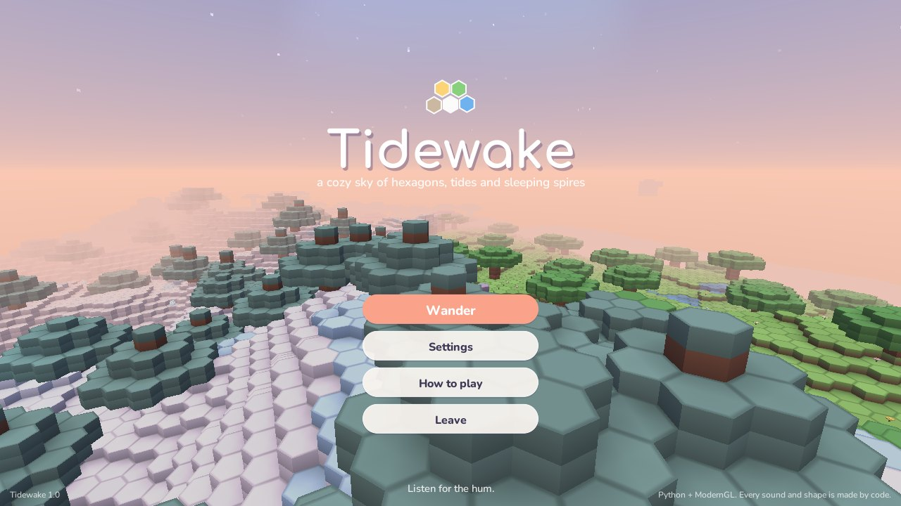

Tidewake is a calm exploration game set on an endless archipelago of floating islands that drift above a sea of clouds.
The world is built from **hexagonal prism cells**, not cubes. You never mine, craft or fight. Instead you **gather** a cell
to draw out its elements, **tune** a chord of one or two elements, and **shape** that form back into the world, where many
forms come alive: water flows and pours off cliffs, vines creep, crystals grow in the dusk and blooms spread in the light.

Ancient **spires** sleep on every sky. Each one longs for certain tuned cells around its base. Wake one and it lights up,
fills you with light and teaches you a gift.

## Download (Windows)

1. Open the [latest release](../../releases/latest) and download **Tidewake-1.0-Windows.zip**.
2. Right-click the zip, choose **Extract All…**, and open the extracted `Tidewake` folder.
3. Double-click **Tidewake.exe**.

Windows may show a blue "Windows protected your PC" box because the game isn't signed. Click **More info**, then **Run anyway**.
Your skies, settings and snapshots are saved in the same folder as the exe (`skies/`, `settings.json`, `snapshots/`).

## How it plays

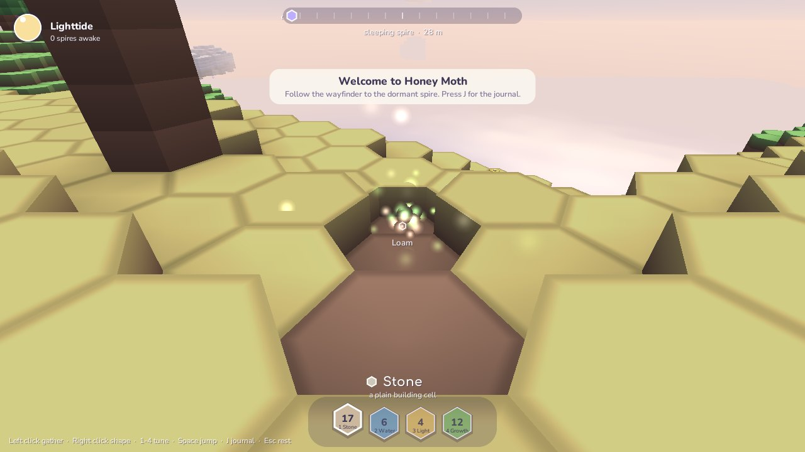

**The four elements.** Every cell holds some mix of **Stone**, **Water**, **Light** and **Growth**. Left-click a cell to gather it.
It dissolves into motes of essence that float into you.

**Tuning.** Press keys 1-4 (or roll the mouse wheel) to choose one or two elements. Each chord makes a different form:

| Chord | Form | What it does |
|---|---|---|
| Stone | Stone | a plain building cell |
| Water | Water | flows, falls and pools |
| Light | Lantern | a warm light |
| Growth | Sprout | grows into a tree on turf |
| Stone + Water | Clay | soft terracotta for building |
| Stone + Light | Crystal | grows taller in the dusk tide |
| Stone + Growth | Mossrock | slowly greens the stone around it |
| Water + Light | Cloudstuff | springy: bounce on it |
| Water + Growth | Vine | creeps down cliffs; climb it |
| Light + Growth | Bloom | glowing flowers that spread in the light |

Right-click to shape your tuned form into the world.

**Tides, not days.** Instead of day and night, the sky turns between a warm **Lighttide** and a violet **Dusktide** (about 12
minutes a cycle). Growth happens in the light. Crystals, blooms and lanterns shine in the dusk, and golden dusk motes
drift around you. Walk through them to gather Light.

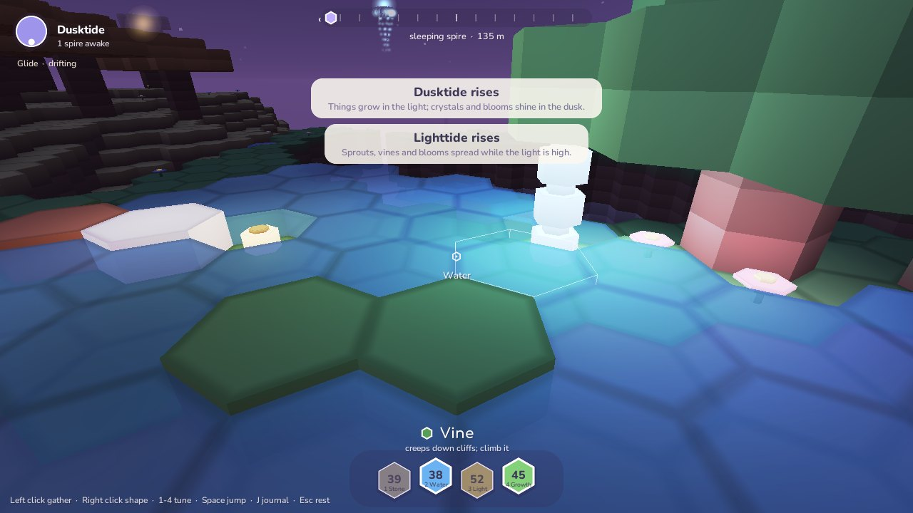

**Spires and gifts.** The wayfinder at the top of the screen points to the nearest sleeping spire, and looking at one
tells you what it longs for. Shape those forms on the six hexes around its base to wake it. Your gifts arrive in order:
**Glide** (hold Space while falling), **Updraft** (a second jump in mid-air) and **Tidecall** (T calls the next tide).

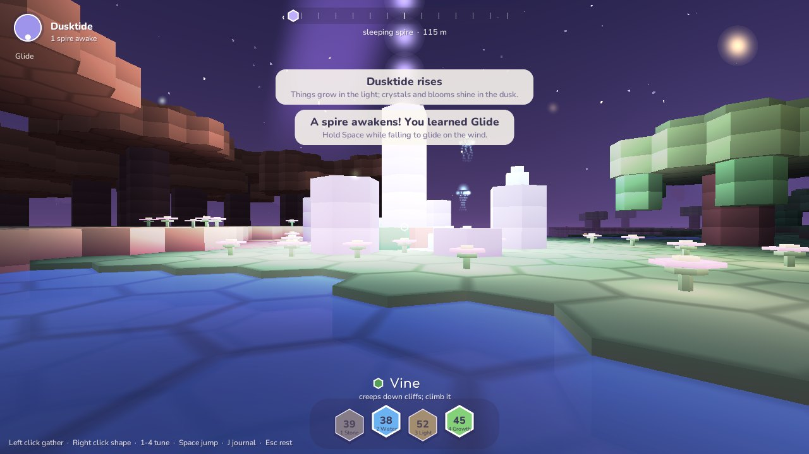

**Nothing can hurt you.** If you step off an island, the cloud sea catches you and carries you back to the last solid ground.
Cloudstuff gives you a big bounce.

**Endless, seeded skies.** Every sky is generated from a seed (a number or any words you like) and goes on forever. Each seed
also rolls its own temperament: big continents or scattered skerries, high or low islands, many spires or few. There are
eight realms: Meadow Isles, Amberwood, Rose Mesas, Frostglass, Basalt Steps, Mossfen, Duneglass and the glowing Lumen Grove.
Positions are rendered relative to the camera, so the world stays smooth even a billion cells from home.

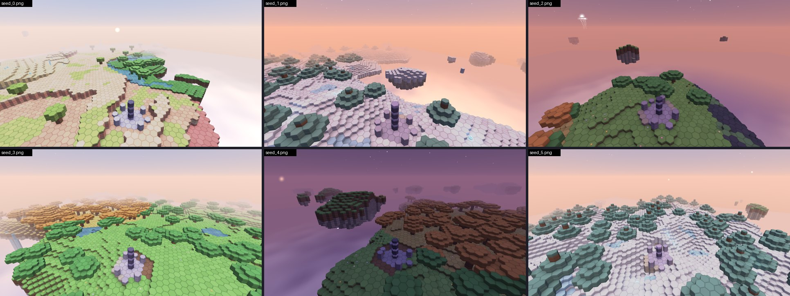

**Two ways to play.** *Wanderer* is the normal game. *Dreamer* gives you endless essence and every gift, and F lets you drift freely.

## Controls

| Key | Does |
|---|---|
| W A S D + mouse | wander and look |
| Space | jump · hold to glide · climb vines |
| Shift | hurry |
| Left click | gather a cell into essence |
| Right click | shape your tuned form |
| 1 2 3 4 | toggle Stone, Water, Light, Growth |
| Mouse wheel | cycle through forms |
| J or Tab | journal (tuning, spires, gifts, controls) |
| T | tidecall (once learned) |
| F | drift freely (Dreamer skies) |
| Enter or / | whisper a command: `/tp x z`, `/tide dusk`, `/tide light`, `/seed`, `/spire` |
| F1 · F2 · F3 | hide HUD · take a snapshot · details |
| F11 | fullscreen |
| Esc | rest (pause, settings, save and leave) |

## More pictures

| | |
|---|---|
| 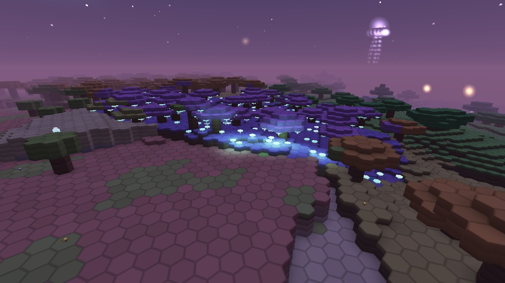 | 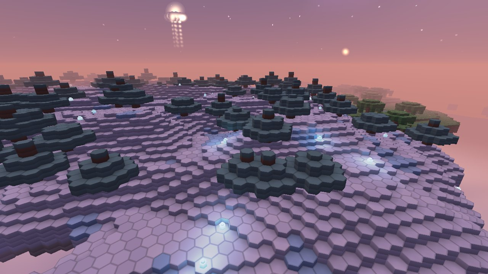 |
| 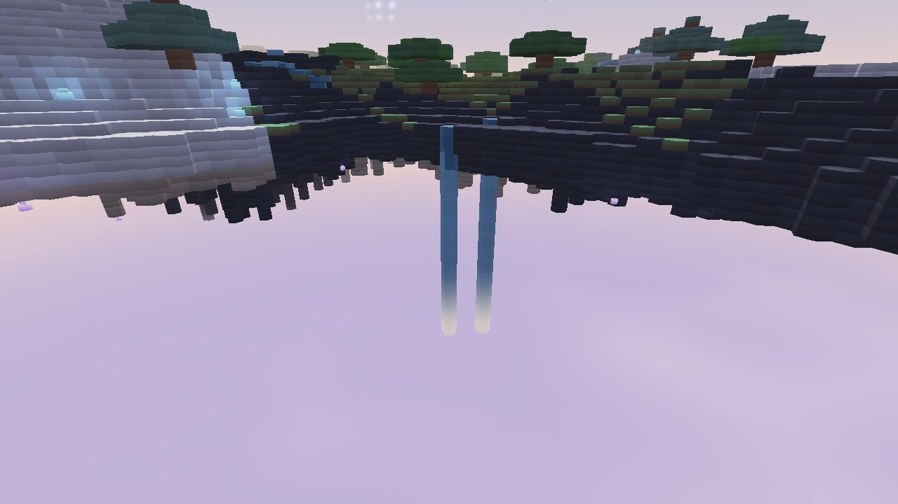 | 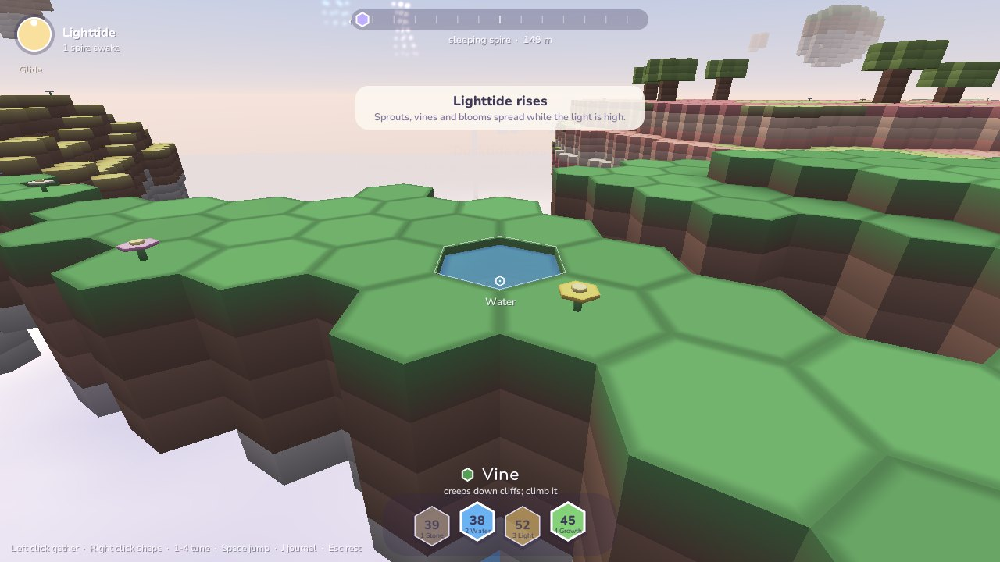 |
| 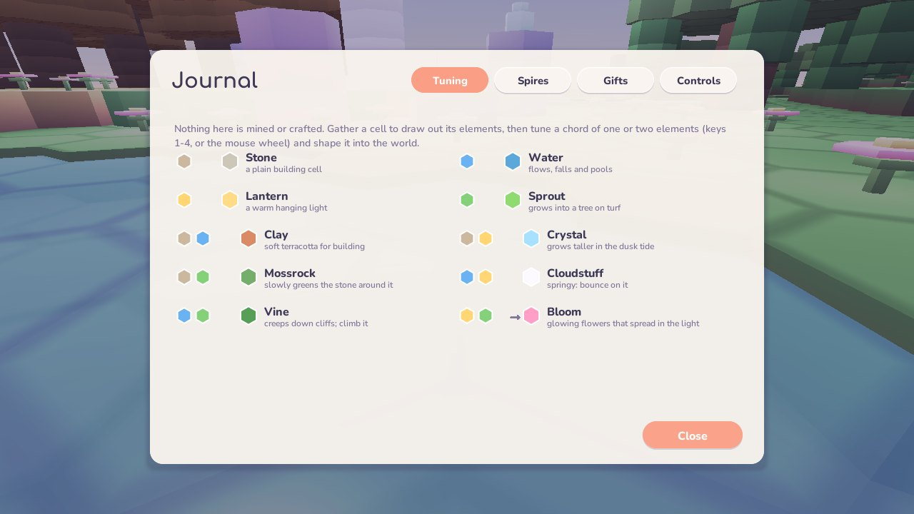 | 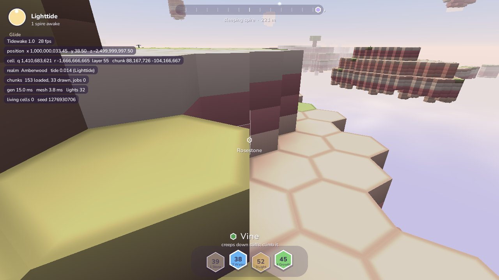 |

## Run from source

Python 3.12 is recommended.

```
python -m venv venv
venv\Scripts\activate        (on macOS/Linux: source venv/bin/activate)
pip install -r requirements.txt
python main.py
```

On Windows you can also double-click `run.bat` after installing the requirements.

Options: `--size 1600x900`, `--workers N` (background world builders), `--data PATH` (where skies and settings are kept).

### Building the Windows exe

```
pip install pyinstaller
pyinstaller Tidewake.spec
```

The game ends up in `dist/Tidewake/`.

## Under the hood

* Python, [pyglet](https://pyglet.org) for the window, input and sound, [moderngl](https://github.com/moderngl/moderngl) for OpenGL 3.3, and numpy for everything heavy.
* Pointy-top hex cells in axial coordinates, 16×16-column chunks that are 128 layers tall. Generation and meshing run in worker processes and stream closest-first.
* All sounds and music are generated in code: a soft pad and pentatonic bells that follow the tide.
* Fonts: Comfortaa and Nunito (SIL Open Font License, see `assets/fonts/OFL.txt`), bundled as renamed static instances.

Made with love, and no cubes.
